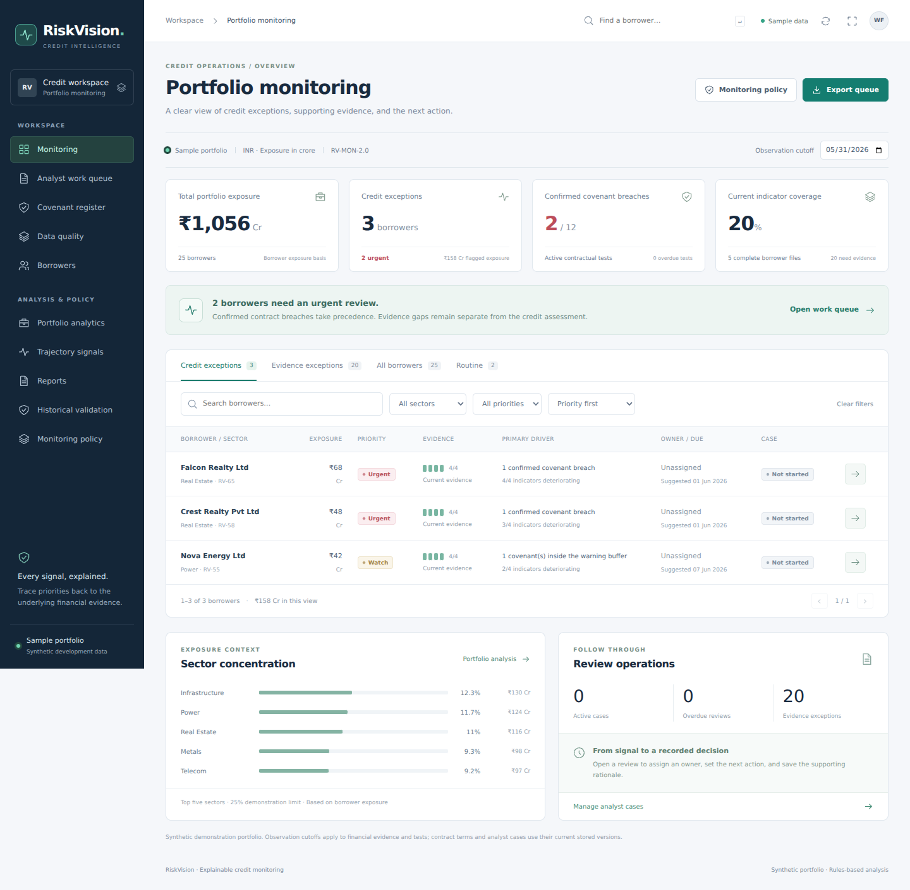

# RiskVision: professional monitoring demo



For the latest workflow, benchmark research and a two-minute recording plan, read [MONITORING_UPGRADE.md](MONITORING_UPGRADE.md).

## Already installed the first demo?

Use `RiskVision-Professional-Update.zip`. Stop RiskVision with Ctrl+C, extract the update, and double-click `APPLY_UPDATE.bat`. It locates the original folder in Downloads, checks source files, and makes a backup. Then double-click `START_RISKVISION.bat` in your original project folder. Existing packages and demo data are reused.

## Fresh installation on Windows

Extract `RiskVision-Professional-v2.zip` into its own folder. Open the inner folder containing `start_demo.py`, `frontend`, and `backend`. Type `powershell` in File Explorer's address bar and press Enter.

Run these commands one at a time:

```powershell
python -m venv .venv
.\.venv\Scripts\python.exe -m pip install -r backend\requirements.txt
cd frontend
npm.cmd ci
cd ..
.\.venv\Scripts\python.exe start_demo.py
```

The browser opens at http://127.0.0.1:5173. Keep the terminal open. Press Ctrl+C to stop. Python 3.12 and Node.js 24 were used for development verification. The launcher's frontend dependencies require a compatible Node release; Node.js 24 is the straightforward choice.

For later runs, double-click `START_RISKVISION.bat` or use the final Python command above. The sample database stays under `backend/.demo/`. It contains synthetic workbook data, metric histories, facilities, covenants, and the cases you save. The demo does not connect to your configured PostgreSQL database.

On macOS/Linux, create and install the environment similarly, then run `.venv/bin/python start_demo.py`.

## Recording sequence

1. Start at **Monitoring**: 25 borrowers, ₹1,056 Cr, 3 credit exceptions, 2 urgent reviews, and 20% current indicator coverage.
2. Open **Falcon Realty**. Show financial trends and dated source evidence.
3. Show **Covenants**: actual values versus contractual limits and the confirmed breach.
4. Open a review, assign an owner and due date, add a next action and rationale, and **Save decision**. Show the recorded decision and **Export review**.
5. Show **Data quality** and **Monitoring policy**. Explain why missing evidence requires review rather than a healthy classification.

Use F11 for a clean recording, and rehearse these clicks once. The sample deliberately opens at 31 May 2026, the fixture's last observation date. Changing the cutoff demonstrates how older evidence becomes stale. Cutoffs follow into borrower analysis. They do not reconstruct historical contract versions or historical analyst cases.

## Existing PostgreSQL workspace

Preserve your existing `backend/.env` and database. The original borrower, observation, facility and covenant schemas must already exist. The API adds only the two monitoring-case tables automatically at startup.

```powershell
.\.venv\Scripts\python.exe -m uvicorn main:app --app-dir backend --host 127.0.0.1 --port 8000
```

In a second terminal:

```powershell
cd frontend
npm.cmd run dev
```

`VITE_API_BASE_URL` configures the frontend API address. If using a different frontend origin, explicitly set `RISKVISION_ALLOWED_ORIGINS` on the backend to a comma-separated list of trusted origins. Default allowed origins are `http://127.0.0.1:5173` and `http://localhost:5173`.

## Review persistence and scope

Saved reviews now live in the workspace database. They include the owner, status, due date, next action, rationale, actual save timestamp, and the supporting assessment. A version check prevents silent overwrites from another browser window. Existing v1 browser notes are retained and offered as a draft for unsaved cases.

The app uses deterministic demonstration policies, not a trained default model or autonomous underwriting. The journal has user-entered actor names, not authenticated roles or a tamper-proof regulatory audit trail. No notification is sent when a review is saved or escalated. Real production controls and feeds are described in the upgrade guide.

## Verification commands

```powershell
.\.venv\Scripts\python.exe backend\demo.py --seed-only
$env:RISK_DEMO_MODE = "1"
.\.venv\Scripts\python.exe -m unittest discover -s backend\tests -p "test_*.py" -v
Remove-Item Env:RISK_DEMO_MODE
cd frontend
npm.cmd run lint
npm.cmd run build
```
